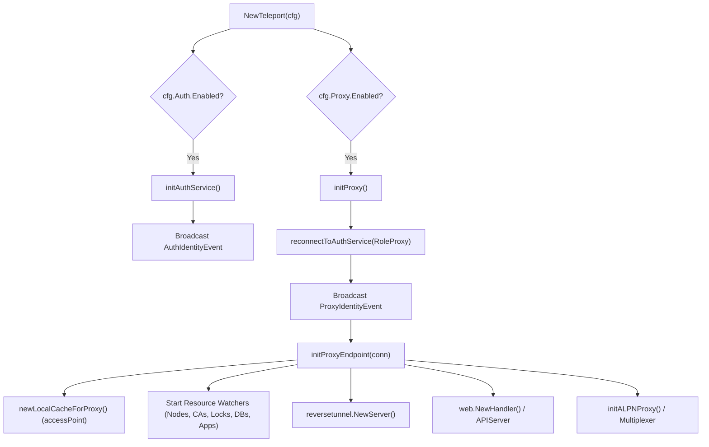

# 01 - Process Startup & Service Lifecycle

A single `teleport` binary can run the **Auth Service**, **Proxy Service**, and any combination of agent services (SSH, Kubernetes, Database, Application, Windows Desktop, Discovery). Everything is coordinated by [`TeleportProcess`](file:///home/strawhat/project/teleport/lib/service/service.go#L618-L756) in [`lib/service/service.go`](file:///home/strawhat/project/teleport/lib/service/service.go).

---

## 1. Event-Driven Supervisor Pattern

`TeleportProcess` embeds [`service.Supervisor`](file:///home/strawhat/project/teleport/lib/service/supervisor.go), which provides:
* **Service registration (`RegisterFunc`)**: Background goroutines managed by the process lifecycle.
* **Event Bus (`BroadcastEvent` / `WaitForEvent`)**: Services wait for prerequisite events (such as obtaining a signed identity from Auth) before starting their listeners.

---

## 2. Step-by-Step Initialization

### Step A: `NewTeleport` Entrypoint
* **Code**: [`NewTeleport`](file:///home/strawhat/project/teleport/lib/service/service.go#L884-L1400)
* Validates the configuration (`servicecfg.Config`), sets up local state storage on disk (`/var/lib/teleport`), and initializes whichever services are enabled in `teleport.yaml`.

### Step B: Auth Service Initialization (`initAuthService`)
* **Code**: [`TeleportProcess.initAuthService`](file:///home/strawhat/project/teleport/lib/service/service.go#L2260-L3150)
* Runs **only** if `auth_service.enabled: true`.
* Performs the following in order:
  1. **Storage Backend**: Calls [`initAuthStorage`](file:///home/strawhat/project/teleport/lib/service/service.go#L7441) to open the configured backend (`lite`/SQLite, `dynamodb`, `firestore`, `etcd`, or `postgres`).
  2. **Keystore & HSM/KMS**: Initializes [`keystore.NewManager`](file:///home/strawhat/project/teleport/lib/service/service.go#L2328-L2331) for managing CA private keys (raw software keys, PKCS#11 HSM, AWS KMS, or GCP KMS).
  3. **Audit Log & Session Recording**: Sets up the audit event emitter and session recording streamer (local filesystem or external cloud storage like S3/GCS/Athena).
  4. **Auth Server Creation**: Calls [`auth.Init`](file:///home/strawhat/project/teleport/lib/auth/init.go) to create [`auth.Server`](file:///home/strawhat/project/teleport/lib/auth/auth.go#L1311-L1435), generate initial Certificate Authorities (`HostCA`, `UserCA`, `DatabaseCA`, `OpenSSHCA`, `JWTCA`, etc.) if bootstrapping for the first time, and start the Auth cache.
  5. **mTLS Server**: Wraps the Auth server in [`auth.NewTLSServer`](file:///home/strawhat/project/teleport/lib/auth/middleware.go#L143) and begins listening on the Auth address (default `:3025`) and broadcasts `AuthIdentityEvent`.

### Step C: Proxy Identity Acquisition (`connectToAuthService`)
* **Code**: [`TeleportProcess.initProxy`](file:///home/strawhat/project/teleport/lib/service/service.go#L4807-L4855) → [`reconnectToAuthService`](file:///home/strawhat/project/teleport/lib/service/connect.go#L75-L129) → [`connectToAuthService`](file:///home/strawhat/project/teleport/lib/service/connect.go#L160-L240)
* Before the Proxy can accept traffic, it needs a valid `RoleProxy` identity (an SSH host cert and an x509 mTLS cert signed by Auth's `HostCA`):
  * If running in the **same process** as Auth or with valid certs already on disk (`/var/lib/teleport/proc`), it loads its existing identity and builds an `authclient.ClientI`.
  * If joining for the **first time** (or rotating), it runs the join protocol using the configured token/join method and writes the signed credentials to disk.
* Once connected, it broadcasts `ProxyIdentityEvent` with a [`Connector`](file:///home/strawhat/project/teleport/lib/service/service.go#L455-L495) containing both the Proxy's TLS/SSH identity and its authenticated `authclient.ClientI` to Auth.

### Step D: Proxy Endpoint Setup (`initProxyEndpoint`)
* **Code**: [`TeleportProcess.initProxyEndpoint`](file:///home/strawhat/project/teleport/lib/service/service.go#L5217-L5600)
* Triggered when `ProxyIdentityEvent` is received:
  1. **Local Cache (`accessPoint`)**: Calls [`newLocalCacheForProxy`](file:///home/strawhat/project/teleport/lib/service/service.go#L5246), creating an in-memory [`cache.Cache`](file:///home/strawhat/project/teleport/lib/cache/cache.go) backed by a gRPC event watch stream (`NewWatcher`) from Auth. This allows the Proxy to read CAs, nodes, roles, locks, and cluster config from memory without hitting Auth on every connection.
  2. **Resource Watchers**: Initializes specialized watchers ([`LockWatcher`](file:///home/strawhat/project/teleport/lib/service/service.go#L5281), [`NodeWatcher`](file:///home/strawhat/project/teleport/lib/service/service.go#L5292), [`CertAuthorityWatcher`](file:///home/strawhat/project/teleport/lib/service/service.go#L5325), [`AppServersWatcher`](file:///home/strawhat/project/teleport/lib/service/service.go#L5343), [`DatabaseServerWatcher`](file:///home/strawhat/project/teleport/lib/service/service.go#L5354)).
  3. **Listeners & Multiplexers**: Calls [`setupProxyListeners`](file:///home/strawhat/project/teleport/lib/service/service.go#L5256) to bind the Web/Public port (`:3080` or `:443`), SSH Proxy port (`:3023`), Reverse Tunnel port (`:3024`), Kube port (`:3026`), and Peer Proxy port (`:3021`).
  4. **Sub-servers**: Starts the Reverse Tunnel server, Proxy Router, Web API handler, and ALPN Proxy router.
