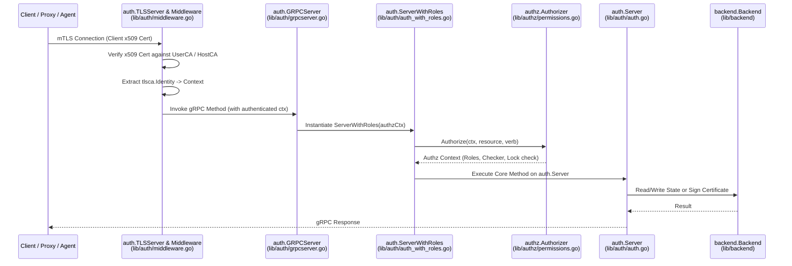

# 02 - Auth Service Request Pipeline

The **Auth Service** is the central Certificate Authority (CA), identity provider, RBAC policy engine, and state store for a Teleport cluster. Every RPC or HTTP call to Auth passes through a strict four-stage pipeline.

---

## 1. Architecture of an Auth Request

---

## 2. The Four Stages in Detail

### Stage 1: mTLS Termination & Identity Extraction (`lib/auth/middleware.go`)
* **Key Types**: [`TLSServer`](file:///home/strawhat/project/teleport/lib/auth/middleware.go#L125-L145) and [`Middleware`](file:///home/strawhat/project/teleport/lib/auth/middleware.go#L347-L385)
* **How it works**:
  1. When a client connects to Auth, `TLSServer` requires a client certificate signed by the cluster's `UserCA` (for users) or `HostCA` (for system components like Proxy, Node, Kube, DB).
  2. On every gRPC unary or streaming call, [`withAuthenticatedUserUnaryInterceptor`](file:///home/strawhat/project/teleport/lib/auth/middleware.go#L585-L594) and [`withAuthenticatedUserStreamInterceptor`](file:///home/strawhat/project/teleport/lib/auth/middleware.go#L596-L603) call [`Middleware.withAuthenticatedUser`](file:///home/strawhat/project/teleport/lib/auth/middleware.go#L533-L573).
  3. `withAuthenticatedUser` inspects the peer's TLS certificate ([`certFromConnState`](file:///home/strawhat/project/teleport/lib/auth/middleware.go#L575)), parses the ASN.1 subject/extensions into a [`tlsca.Identity`](file:///home/strawhat/project/teleport/lib/tlsca/ca.go), wraps it in an `authz` user object (`LocalUser`, `BuiltinRole`, or `RemoteUser`), and stores it in the Go `context.Context`.
  4. It also validates client/agent version compatibility ([`ValidateClientVersion`](file:///home/strawhat/project/teleport/lib/auth/middleware.go#L424)).

### Stage 2: Transport Layer (`lib/auth/grpcserver.go`)
* **Key Type**: [`GRPCServer`](file:///home/strawhat/project/teleport/lib/auth/grpcserver.go#L223-L295) (plus modular sub-services under `lib/auth/*/*v1`, such as `usersv1`, `presencev1`, `trustv1`).
* **How it works**:
  * Unmarshals the protobuf request and calls [`g.authenticate(ctx)`](file:///home/strawhat/project/teleport/lib/auth/grpcserver.go#L6875-L6920) to construct a per-request [`grpcContext`](file:///home/strawhat/project/teleport/lib/auth/grpcserver.go#L6837-L6857) containing a [`ServerWithRoles`](file:///home/strawhat/project/teleport/lib/auth/auth_with_roles.go#L95-L140) bound to the caller's identity.

### Stage 3: Authorization & RBAC Enforcement (`lib/auth/auth_with_roles.go` & `lib/authz`)
* **Key Types**: [`ServerWithRoles`](file:///home/strawhat/project/teleport/lib/auth/auth_with_roles.go#L95-L140) and [`authz.Authorizer`](file:///home/strawhat/project/teleport/lib/authz/permissions.go#L167-L170)
* **Why it exists**:
  * [`auth.Server`](file:///home/strawhat/project/teleport/lib/auth/auth.go#L1311) intentionally does **not** perform RBAC checks so internal Auth subsystems can call it directly. All external calls **must** go through `ServerWithRoles` (or a versioned gRPC service that calls `authz.Authorize` directly).
* **How it works**:
  1. `ServerWithRoles` calls helper methods like [`actionWithContext`](file:///home/strawhat/project/teleport/lib/auth/auth_with_roles.go#L163-L178), [`actionForResource`](file:///home/strawhat/project/teleport/lib/auth/auth_with_roles.go#L154-L161), or [`hasBuiltinRole`](file:///home/strawhat/project/teleport/lib/auth/auth_with_roles.go#L368-L377).
  2. [`Authorizer.Authorize`](file:///home/strawhat/project/teleport/lib/authz/permissions.go#L298-L520) fetches the user's roles from the Auth cache, checks whether any **Locks** (`types.Lock`) apply to the user/role/device, evaluates Role `allow`/`deny` rules for the target `(namespace, resource_kind, verb)` tuple, and verifies MFA or Device Trust requirements if enforced by the role.
  3. If authorized, `ServerWithRoles` delegates the call to the underlying `auth.Server`.

### Stage 4: Core Authority & State (`lib/auth/auth.go` & `lib/services/local`)
* **Key Type**: [`auth.Server`](file:///home/strawhat/project/teleport/lib/auth/auth.go#L1311-L1435)
* **Responsibilities**:
  * **Certificate Signing**: Uses [`keystore.Manager`](file:///home/strawhat/project/teleport/lib/auth/keystore) to sign SSH and TLS certificates for users (`GenerateUserTestCerts` / `generateUserCert`) and hosts (`GenerateHostCerts`).
  * **Resource Services**: Embeds domain services implemented in [`lib/services/local`](file:///home/strawhat/project/teleport/lib/services/local) (e.g., `PresenceService`, `UserService`, `AccessService`, `DynamicAccessService`, `IdentityService`) which serialize resources into the [`backend.Backend`](file:///home/strawhat/project/teleport/lib/backend).
  * **Cache Fan-out**: Writes to the backend emit events via the backend watcher, which [`auth.Server`](file:///home/strawhat/project/teleport/lib/auth/auth.go#L1311) streams out to connected Proxies and Agents via `WatchEvents` ([`GRPCServer.WatchEvents`](file:///home/strawhat/project/teleport/lib/auth/grpcserver.go#L3340)).
