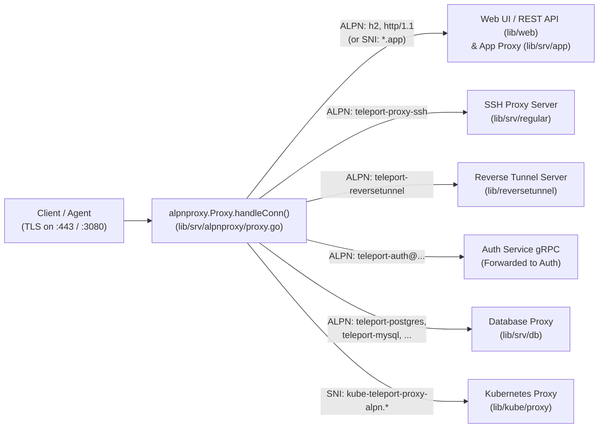

# 03 - Proxy Service & ALPN/TLS Routing

The **Proxy Service** is a stateless gateway at the edge of a Teleport cluster. It holds no persistent state of its own and no CA private keys; instead, it maintains an in-memory read cache (`accessPoint`) streamed from the Auth Service and routes connections between clients and backend services.

---

## 1. Single-Port TLS Routing (`lib/srv/alpnproxy`)

In modern Teleport deployments (`tls_routing_enabled: true`), all client and agent protocols connect to a **single public TLS port** (e.g., `:443` or `:3080`).

[`alpnproxy.Proxy`](file:///home/strawhat/project/teleport/lib/srv/alpnproxy/proxy.go#L246-L270) inspects the TLS `ClientHello` **ALPN** (Application-Layer Protocol Negotiation) and **SNI** (Server Name Indication) values in [`handleConn`](file:///home/strawhat/project/teleport/lib/srv/alpnproxy/proxy.go#L402-L471) and routes the connection to the appropriate internal handler:

### Key Code Paths in `lib/srv/alpnproxy/proxy.go`
* [`Proxy.Serve`](file:///home/strawhat/project/teleport/lib/srv/alpnproxy/proxy.go#L331-L379): Accepts raw TCP connections on the public listener.
* [`Proxy.handleConn`](file:///home/strawhat/project/teleport/lib/srv/alpnproxy/proxy.go#L402-L471):
  * Peeks at the `ClientHello` or terminates TLS using [`getTLSConfig`](file:///home/strawhat/project/teleport/lib/srv/alpnproxy/proxy.go#L536-L547).
  * Matches the negotiated ALPN/SNI against registered routes in [`getHandlerDescBaseOnClientHelloMsg`](file:///home/strawhat/project/teleport/lib/srv/alpnproxy/proxy.go#L623-L632).
  * Enforces IP pinning if the client certificate requires it ([`checkCertIPPinning`](file:///home/strawhat/project/teleport/lib/srv/alpnproxy/proxy.go#L473-L502)).
  * Invokes the matched handler's `HandlerFunc`.

---

## 2. Reverse Tunnel Server & Proxy Peering (`lib/reversetunnel` & `lib/proxy/peer`)

Agents (SSH nodes, DB services, Kube services, App services) and Leaf Clusters often run in private VPCs without public IPs. They dial **outbound** to the Proxy's Reverse Tunnel Server.

* **Reverse Tunnel Server ([`lib/reversetunnel/srv.go`](file:///home/strawhat/project/teleport/lib/reversetunnel/srv.go))**:
  * [`reversetunnel.server`](file:///home/strawhat/project/teleport/lib/reversetunnel/srv.go#L87-L135) is an SSH server that authenticates incoming agent connections in [`keyAuth`](file:///home/strawhat/project/teleport/lib/reversetunnel/srv.go#L923-L1009) using the cluster's `HostCA`.
  * When an agent opens a `teleport-transport` or heartbeat SSH channel ([`HandleNewChan`](file:///home/strawhat/project/teleport/lib/reversetunnel/srv.go#L699-L727)), the server registers the active tunnel in its [`localCluster`](file:///home/strawhat/project/teleport/lib/reversetunnel/local_cluster.go) pool ([`upsertServiceConn`](file:///home/strawhat/project/teleport/lib/reversetunnel/srv.go#L1047-L1073)) or [`leafCluster`](file:///home/strawhat/project/teleport/lib/reversetunnel/leaf_cluster.go) pool ([`upsertRemoteCluster`](file:///home/strawhat/project/teleport/lib/reversetunnel/srv.go#L1075-L1116)).
* **High Availability & Proxy Peering ([`lib/proxy/peer`](file:///home/strawhat/project/teleport/lib/proxy/peer))**:
  * When running multiple Proxy replicas behind a load balancer, an agent may only be connected to `Proxy-B` while a user lands on `Proxy-A`.
  * `Proxy-A` discovers which Proxy holds the tunnel to the target agent and dials `Proxy-B` directly over the **Proxy Peering** service (`lib/proxy/peer`) to bridge the connection without requiring every agent to connect to every Proxy.

---

## 3. Connection Router (`lib/proxy/router.go`)

[`proxy.Router`](file:///home/strawhat/project/teleport/lib/proxy/router.go#L179-L205) unifies connection routing across local nodes, reverse tunnels, peer proxies, and leaf clusters:
* **[`Router.DialHost`](file:///home/strawhat/project/teleport/lib/proxy/router.go#L217-L313)**: Resolves the target SSH node (via [`getServer`](file:///home/strawhat/project/teleport/lib/proxy/router.go#L475-L488) using `NodeWatcher`) and dials it either directly over TCP (if the node advertises a reachable address) or through the Reverse Tunnel pool (if the node is connected via a tunnel).
* **[`Router.DialSite`](file:///home/strawhat/project/teleport/lib/proxy/router.go#L638-L672)**: Connects to the Auth Server (for the local cluster) or to the remote Proxy/Auth of a trusted Leaf Cluster.
