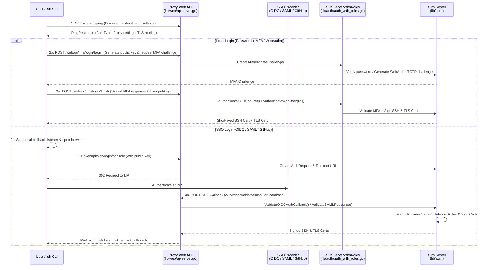

# 04 - User Authentication Flow (`tsh login` & Web UI)

Instead of static SSH keys or long-lived tokens, Teleport authenticates users via **Local Auth (Password + MFA / Passwordless WebAuthn)** or **SSO (OIDC, SAML, GitHub)** and issues short-lived **SSH Certificates** and **x509 TLS Certificates** signed by the Auth Service's `UserCA`.

---

## 1. End-to-End Sequence Diagram

---

## 2. Key Steps & Code References

### Step 1: Discovery (`/webapi/ping`)
* **Client**: [`tsh`](file:///home/strawhat/project/teleport/tool/tsh/common/tsh.go) calls `webclient.Ping` against the Proxy's public HTTPS address.
* **Proxy**: Handled in [`lib/web/apiserver.go`](file:///home/strawhat/project/teleport/lib/web/apiserver.go) (`pingHandler`), returning cluster authentication preferences (whether local auth, passwordless, OIDC, SAML, or GitHub is default) and proxy connection endpoints.

### Step 2A: Local Authentication Flow (`lib/auth/methods.go`)
1. `tsh` generates an ephemeral keypair locally (or uses a hardware-bound key) and requests an MFA challenge.
2. The Proxy forwards the login request to Auth's [`ServerWithRoles.AuthenticateSSHUser`](file:///home/strawhat/project/teleport/lib/auth/auth_with_roles.go#L658-L667) (or [`AuthenticateWebUser`](file:///home/strawhat/project/teleport/lib/auth/auth_with_roles.go#L647-L656) for Web UI sessions).
3. [`auth.Server.AuthenticateSSHUser`](file:///home/strawhat/project/teleport/lib/auth/methods.go#L786) verifies the user's password/MFA via `AuthenticateUser` and [`ValidateMFAAuthResponse`](file:///home/strawhat/project/teleport/lib/auth/auth.go#L8599), checks login rules, and generates signed SSH + TLS certificates.

### Step 2B: SSO Authentication Flow (`lib/auth/oidc.go`, `lib/auth/saml.go`, `lib/auth/github.go`)
1. `tsh` starts a temporary HTTP server on `127.0.0.1` and opens the user's browser to the Proxy's SSO login endpoint (`lib/web/apiserver.go`).
2. The Proxy asks Auth to create an `OIDCAuthRequest` / `SAMLAuthRequest` / `GithubAuthRequest` storing the client's public key and state token, then redirects the browser to the external Identity Provider (IdP).
3. After authenticating, the IdP redirects the browser back to the Proxy callback route, which calls:
   * **OIDC**: [`Server.ValidateOIDCAuthCallback`](file:///home/strawhat/project/teleport/lib/auth/oidc.go#L152)
   * **SAML**: [`Server.ValidateSAMLResponse`](file:///home/strawhat/project/teleport/lib/auth/saml.go#L238)
   * **GitHub**: [`Server.ValidateGithubAuthCallback`](file:///home/strawhat/project/teleport/lib/auth/github.go#L433)
4. Auth verifies the cryptographic signature/token from the IdP, runs any configured **Login Rules** (`lib/loginrule`) to transform external claims/traits, maps traits to Teleport roles, creates a transient `types.User` record in the backend, and signs the user's public key.

### Step 3: Certificate Issuance
* **SSH Certificate**: Signed by the cluster `UserCA` with principals (allowed OS logins) and Teleport extensions (`teleport-roles`, `teleport-traits`, MFA/device extensions).
* **TLS Certificate**: Signed by the cluster `UserCA` with subject fields encoding [`tlsca.Identity`](file:///home/strawhat/project/teleport/lib/tlsca/ca.go) (username, roles, traits, active access requests, cluster name, and device trust extensions).
* `tsh` writes these certificates to `~/.tsh/keys/<proxy>/<user>` and uses them for all subsequent connections until their TTL expires.
