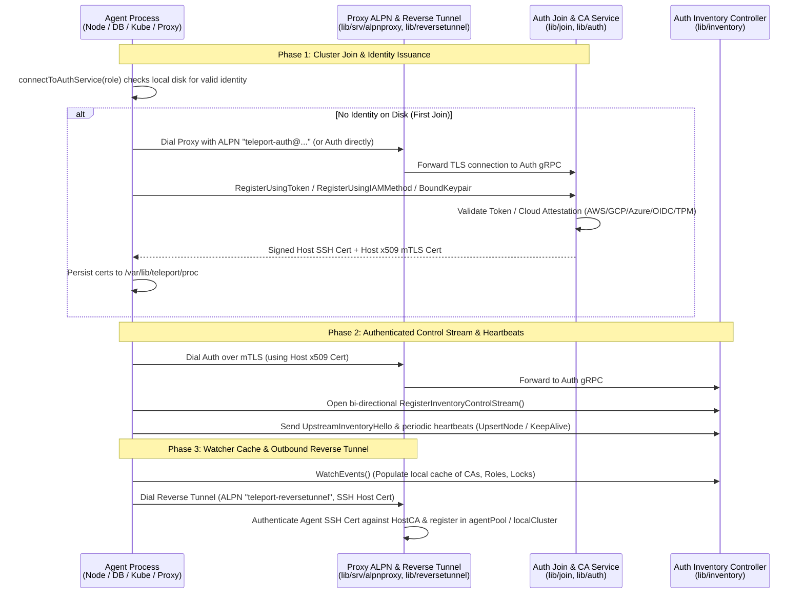

# 05 - Agent Joining, Heartbeats & Reverse Tunnels

Every Teleport service—including **Proxies**, **SSH Nodes**, **Kubernetes Agents**, **Database Agents**, and **Application Agents**—must join the cluster to obtain a signed `HostCA` identity, maintain a control stream with Auth, and register a reverse tunnel with the Proxy.

---

## 1. End-to-End Sequence Diagram

---

## 2. Detailed Phases

### Phase 1: Joining the Cluster & Host Certificate Issuance
* **Entrypoint**: [`TeleportProcess.connectToAuthService`](file:///home/strawhat/project/teleport/lib/service/connect.go#L160-L240)
* When an agent starts, it checks its local state directory (`/var/lib/teleport`) via `process.storage.ReadIdentity`.
* If no valid identity exists, the agent runs the join flow ([`lib/join`](file:///home/strawhat/project/teleport/lib/join)):
  * **Static / Dynamic Provision Token**: Validated in [`Server.ValidateToken`](file:///home/strawhat/project/teleport/lib/auth/auth.go#L5862).
  * **Cloud & Workload Attestation (`lib/join/*`)**: Zero-secret joining where Auth verifies cryptographic identity documents or OIDC tokens from AWS IAM (`iamjoin`), AWS EC2 (`ec2join`), GCP (`gcp`), Azure (`azurejoin`), GitHub Actions (`githubactions`), GitLab (`gitlab`), Kubernetes (`kubernetes`), Spacelift, CircleCI, or hardware TPM (`tpmjoin`).
* Once verified, Auth signs the agent's public key with the cluster's `HostCA` (encoding the agent's `HostUUID`, cluster name, and `types.SystemRole` such as `RoleNode`, `RoleProxy`, `RoleDatabase`, `RoleKube`) and returns the `proto.Certs`.
* The agent also runs a background **certificate rotator** in [`lib/service/connect.go`](file:///home/strawhat/project/teleport/lib/service/connect.go) that watches for CA rotations (`CertAuthority` state changes) and automatically calls [`ServerWithRoles.GenerateHostCerts`](file:///home/strawhat/project/teleport/lib/auth/auth_with_roles.go#L700-L755) before its existing certificate expires.

### Phase 2: Inventory Control Stream & Heartbeats
* **Code**: [`lib/inventory`](file:///home/strawhat/project/teleport/lib/inventory) and [`ServerWithRoles.RegisterInventoryControlStream`](file:///home/strawhat/project/teleport/lib/auth/auth_with_roles.go#L841-L900)
* After acquiring its `HostCA` mTLS credentials, the agent establishes a persistent bi-directional gRPC stream (`InventoryControlStream`) to the Auth Service.
* Over this stream (and resource heartbeat emitters), the agent:
  * Registers its instance metadata (`types.Instance`) and sub-service heartbeats (`types.ServerV2` for SSH nodes, `types.DatabaseServerV3` for DBs, `types.KubeServerV3` for Kube).
  * Receives control-plane pings and commands from Auth.
* Auth persists these presence records with a short TTL in the backend; when a record is created or updated, Auth's backend watcher broadcasts the update to all connected Proxies.

### Phase 3: Reverse Tunnel Pool (`lib/reversetunnelclient` & `lib/reversetunnel`)
* **Agent Side**: The agent starts an outbound [`reversetunnelclient.AgentPool`](file:///home/strawhat/project/teleport/lib/reversetunnel/agentpool.go) that discovers the cluster's Proxies and dials their reverse tunnel listener (using ALPN `teleport-reversetunnel`).
* **Proxy Side**:
  1. [`reversetunnel.server`](file:///home/strawhat/project/teleport/lib/reversetunnel/srv.go#L87-L135) verifies the agent's SSH certificate against `HostCA` in [`keyAuth`](file:///home/strawhat/project/teleport/lib/reversetunnel/srv.go#L923-L1009).
  2. The agent opens an SSH `teleport-transport` channel ([`HandleNewChan`](file:///home/strawhat/project/teleport/lib/reversetunnel/srv.go#L699-L727)).
  3. The Proxy registers the agent's live SSH connection in its `localCluster` tunnel map ([`upsertServiceConn`](file:///home/strawhat/project/teleport/lib/reversetunnel/srv.go#L1047-L1073)), ready to accept incoming client streams from [`proxy.Router`](file:///home/strawhat/project/teleport/lib/proxy/router.go#L179).
