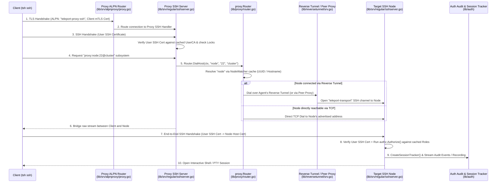

# 06 - Resource Connection Flow (`tsh ssh` / DB / Kube)

Once a user has logged in (see [04 - User Authentication Flow](./04-user-authentication-flow.md)) and an agent has joined the cluster (see [05 - Agent Joining & Heartbeats](./05-agent-joining-and-heartbeats.md)), the user can connect to target resources through the Proxy.

 Crucially, **both the Proxy and the Target Agent enforce authentication and RBAC independently** using their local caches of Auth state.

---

## 1. End-to-End Sequence Diagram (`tsh ssh user@node`)

---

## 2. Step-by-Step Code Walkthrough

### Step 1 & 2: Single-Port ALPN Entry (`lib/srv/alpnproxy/proxy.go`)
* `tsh` initiates a TLS connection to the Proxy's public address with `NextProtos: ["teleport-proxy-ssh"]`.
* [`alpnproxy.Proxy.handleConn`](file:///home/strawhat/project/teleport/lib/srv/alpnproxy/proxy.go#L402-L471) terminates TLS, checks client certificate IP pinning if enabled ([`checkCertIPPinning`](file:///home/strawhat/project/teleport/lib/srv/alpnproxy/proxy.go#L473-L502)), and dispatches the connection to the Proxy's SSH server.

### Step 3 & 4: Proxy SSH Authentication & Subsystem Request (`lib/srv/regular/sshserver.go`)
* The Proxy runs an instance of [`regular.Server`](file:///home/strawhat/project/teleport/lib/srv/regular/sshserver.go#L140-L240) configured in Proxy Mode ([`SetProxyMode`](file:///home/strawhat/project/teleport/lib/srv/regular/sshserver.go#L552-L565)).
* It verifies the client's SSH certificate against the cluster's `UserCA` (fetched from the Proxy's local `accessPoint` cache) and ensures no cluster [`Lock`](file:///home/strawhat/project/teleport/lib/srv/regular/sshserver.go#L350) blocks the user.
* `tsh` requests the `proxy:<host>:<port>@<cluster>` SSH subsystem to instruct the Proxy where to route the inner SSH connection.

### Step 5 & 6: Target Resolution & Tunnel Dialing (`lib/proxy/router.go`)
* The Proxy subsystem invokes [`Router.DialHost`](file:///home/strawhat/project/teleport/lib/proxy/router.go#L217-L313):
  1. **Cluster Check**: Checks whether `<cluster>` is the local cluster or a trusted Leaf Cluster ([`getRemoteCluster`](file:///home/strawhat/project/teleport/lib/proxy/router.go#L400-L427)).
  2. **Node Lookup**: Calls [`getServer`](file:///home/strawhat/project/teleport/lib/proxy/router.go#L475-L488) → [`getServerWithResolver`](file:///home/strawhat/project/teleport/lib/proxy/router.go#L490-L636), querying the Proxy's in-memory `NodeWatcher` cache to match the target node by UUID or hostname/IP.
  3. **Transport Dialing**:
     * If the node's `UseTunnel()` is true (dial-back agent), `DialHost` dials through the Reverse Tunnel server (`reversetunnel.server`), which either uses a local tunnel on this Proxy or forwards over **Proxy Peering** (`lib/proxy/peer`) to the peer Proxy holding the agent's tunnel.
     * If the node is directly dialable on the local network, `DialHost` dials its TCP address directly.
  4. Once the stream to the target node is open, the Proxy pipes bytes between the client's SSH channel and the target node connection (unless `proxy-recording` mode is configured, in which case the Proxy terminates the inner SSH connection itself to record the session at the Proxy).

### Step 7, 8 & 9: Target Node RBAC & Session Recording (`lib/srv/regular/sshserver.go` & `lib/srv`)
* Over the bridged tunnel, `tsh` performs an **end-to-end SSH handshake directly with the Target Node**:
  * `tsh` verifies the Node's `HostCA`-signed host certificate.
  * The Node's [`regular.Server`](file:///home/strawhat/project/teleport/lib/srv/regular/sshserver.go#L519) verifies the user's `UserCA`-signed SSH certificate.
* **Local RBAC Check**: Even though the request came through the Proxy, the Node **never trusts the Proxy blindly**. The Node evaluates the user's roles, node labels (`allow`/`deny` node label matching), principal (`login`), per-session MFA, and locks using its own cached Auth state (`AccessPoint`).
* **Session Tracking & Audit Streaming**:
  * The Node creates a [`SessionTracker`](file:///home/strawhat/project/teleport/lib/auth/auth_with_roles.go#L396) in Auth so other authorized users/moderators can view or join the active session.
  * Session I/O, enhanced BPF events (`lib/bpf`), and audit events (`session.start`, `session.end`, `exec`) are streamed asynchronously back to Auth's audit log and session recording storage via [`events.StreamerAndEmitter`](file:///home/strawhat/project/teleport/lib/events).

---

## 3. How Database & Kubernetes Connections Differ

While SSH runs an end-to-end SSH handshake inside the Proxy tunnel, **Database** and **Kubernetes** protocols work slightly differently:
* **Kubernetes (`lib/kube/proxy`)**:
  * `kubectl` sends an HTTPS request with the user's Teleport mTLS certificate to the Proxy (`ALPN: h2/http/1.1`, `SNI: kube-teleport-proxy-alpn.*`).
  * The Proxy authenticates the user's mTLS certificate, looks up the target `kube_cluster`, and forwards the request over the reverse tunnel to the `kubernetes_service` agent, which impersonates the user's `kubernetes_users` / `kubernetes_groups` against the upstream K8s API server.
* **Databases (`lib/srv/db`)**:
  * Native DB clients (or `tsh proxy db`) connect to the Proxy using the DB-specific ALPN protocol (e.g., `teleport-postgres`) and the user's mTLS certificate.
  * [`alpnproxy.Proxy`](file:///home/strawhat/project/teleport/lib/srv/alpnproxy/proxy.go#L581) routes the connection to the Proxy's [`db.ProxyServer`](file:///home/strawhat/project/teleport/lib/srv/db/proxyserver.go), which authenticates the user and tunnels the stream to the `db_service` agent. The `db_service` agent authorizes the database name/user via RBAC, parses wire-protocol SQL queries for the audit log, and authenticates to the target database using short-lived certs or cloud IAM tokens.
