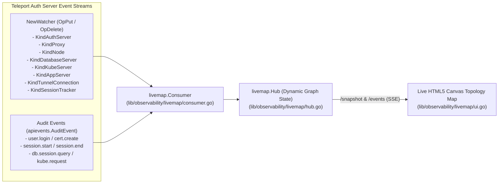

# 07 - Live Cluster Topology & Packet Flow Map (Auth Event Consumer)

To build a live, dynamic map of **what is connected to what**, **which component is sending heartbeats**, **which reverse tunnels are active**, and **which users have live sessions**, we created an **Auth Event Consumer** ([`lib/observability/livemap/consumer.go`](file:///home/strawhat/project/teleport/lib/observability/livemap/consumer.go)) and a standalone CLI utility ([`lib/observability/livemap/cmd/teleport-livemap/main.go`](file:///home/strawhat/project/teleport/lib/observability/livemap/cmd/teleport-livemap/main.go)).

Instead of relying on static or hardcoded nodes, the topology starts completely empty and is **dynamically constructed in real time from Teleport Auth events**.

---

## 1. How the Auth Event Consumer Builds the Topology

[`livemap.Consumer.WatchCluster`](file:///home/strawhat/project/teleport/lib/observability/livemap/consumer.go#L49-L71) subscribes to the Auth Service's real-time `NewWatcher` stream (`types.Watch`) across all core cluster resource kinds, plus `apievents.AuditEvent`s:



### Mapping Auth Events to Graph Nodes & Directed Edges

| Auth Event / Resource | Graph Node(s) Created/Updated | Directed Edge Created/Pulsed | What Payload Data Is Extracted |
| :--- | :--- | :--- | :--- |
| **`OpPut(KindAuthServer)`** | `auth:<name>` | `auth:<name>` (Self/Presence) | `Hostname`, `Addr`, `TeleportVersion`, `Expiry` |
| **`OpPut(KindProxy)`** | `proxy:<name>` | `proxy:<name> ──► auth:<id>` (`HEARTBEAT`) | `Hostname`, `PublicAddr`, `PeerAddr`, `Expiry` |
| **`OpPut(KindNode)`** | `node:<name>` | `node:<name> ──► auth:<id>` (`HEARTBEAT`) | `Hostname`, `Addr`, `UseTunnel`, live TTL (`time.Until(Expiry)`) |
| **`OpPut(KindDatabaseServer)`** | `db:<db_name>` | `db:<db_name> ──► auth:<id>` (`HEARTBEAT`) | `HostID`, `Protocol` (`postgres`, `mysql`, etc.), `URI` |
| **`OpPut(KindKubeServer)`** | `kube:<cluster>` | `kube:<cluster> ──► auth:<id>` (`HEARTBEAT`) | `HostID`, `Cluster.Name` |
| **`OpPut(KindAppServer)`** | `app:<app_name>` | `app:<app_name> ──► auth:<id>` (`HEARTBEAT`) | `HostID`, `App.Name`, `App.URI` |
| **`OpPut(KindTunnelConnection)`** | `<type>:<target>` & `proxy:<proxy_name>` | `<type>:<target> ──► proxy:<proxy_name>` (`TUNNEL_HB`) | Exact Proxy UUID holding the reverse tunnel, `ClusterName`, `TunnelType`, `LastHeartbeat` |
| **`OpPut(KindSessionTracker)`** | `user:<participant>` & `<kind>:<target>` | `user:<participant> ──► <kind>:<target>` (`LIVE_SESSION`) | `SessionID`, `SessionKind` (`ssh`, `k8s`, `db`, `app`), `Login`, `State`, `Participants` |
| **`OpDelete(KindNode / ...)`** | *Removes expired node & incident edges* | Emits `RESOURCE_EXPIRED` | Node/Session name that expired or disconnected |
| **`AuditEvent`** | `user:<user>` & `<kind>:<server_id>` | `user:<user> ──► <kind>:<target>` (`AUDIT_EVENT`) | Event `Type` (`session.start`, `user.login`, etc.), diagnostic `Code`, `Time` |

---

## 2. Running the Standalone CLI Utility Against Any Cluster

You can run [`lib/observability/livemap/cmd/teleport-livemap/main.go`](file:///home/strawhat/project/teleport/lib/observability/livemap/cmd/teleport-livemap/main.go) against any running Teleport cluster:

```bash
# 1. Export an identity file from your Teleport cluster
tctl auth sign --user=admin --out=identity.pem

# 2. Start the live topology consumer utility
go run ./lib/observability/livemap/cmd/teleport-livemap \
  --addr=127.0.0.1:3025 \
  --identity=identity.pem \
  --listen=127.0.0.1:8899
```
Then open **`http://127.0.0.1:8899`** to watch your cluster's live heartbeats, reverse tunnels, and active user sessions.

---

## 3. Running with an In-Memory Test Cluster

You can also run the self-contained test in [`lib/auth/livemap_demo_test.go`](file:///home/strawhat/project/teleport/lib/auth/livemap_demo_test.go), which starts a real in-memory Auth Server, attaches `livemap.Consumer.WatchCluster` over gRPC, and lets you trigger real Auth resource mutations (`InventoryHeartbeat`, `UpsertTunnelConnection`, `CreateSessionTracker`, `DeleteNode`, and `AuditEvent`):

```bash
# Run automated test and print discovered topology summary
go test -v ./lib/auth -run '^TestLiveMapVisualizer$'

# Keep the interactive browser UI open at http://127.0.0.1:8899
LIVEMAP_SERVE=1 go test -v ./lib/auth -run '^TestLiveMapVisualizer$'
```
