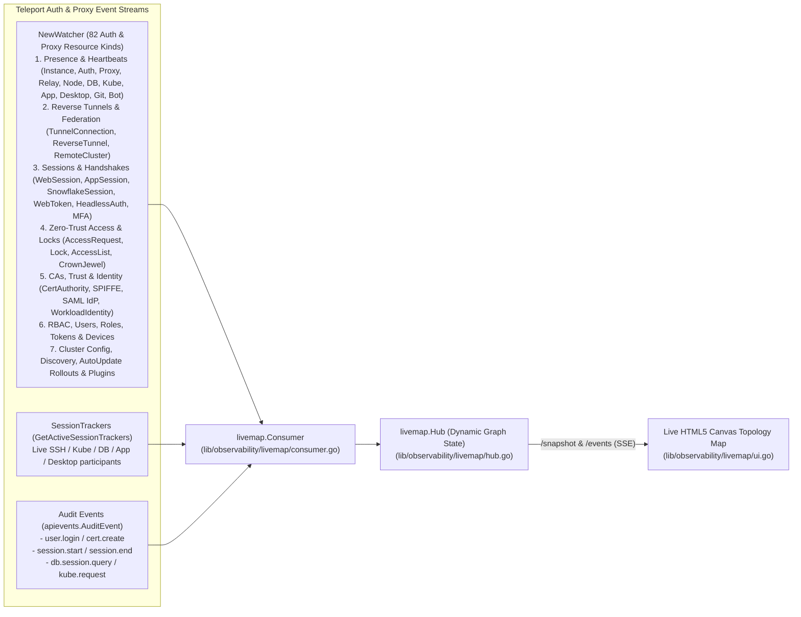

# 07 - Live Cluster Topology & Packet Flow Map (Auth & Proxy Event Consumer)

To build a live, dynamic map of **what is connected to what**, **which component is sending heartbeats**, **which reverse tunnels are active**, **which users have live sessions**, and **what security/RBAC/CA/config changes are occurring**, we created an **Auth & Proxy Event Consumer** ([`lib/observability/livemap/consumer.go`](file:///home/strawhat/project/teleport/lib/observability/livemap/consumer.go)) and a standalone CLI utility ([`lib/observability/livemap/cmd/teleport-livemap/main.go`](file:///home/strawhat/project/teleport/lib/observability/livemap/cmd/teleport-livemap/main.go)).

Instead of relying on static or hardcoded nodes, the topology starts completely empty and is **dynamically constructed in real time from Teleport Auth & Proxy watch events**.

---

## 1. How the Auth & Proxy Event Consumer Builds the Topology

[`livemap.Consumer.WatchCluster`](file:///home/strawhat/project/teleport/lib/observability/livemap/consumer.go#L209-L230) subscribes to the Auth Service's real-time `NewWatcher` stream (`types.Watch`) across **all 82 Auth and Proxy resource watch kinds** ([`DefaultWatchKinds`](file:///home/strawhat/project/teleport/lib/observability/livemap/consumer.go#L76-L184) and [`ProxyWatchKinds`](file:///home/strawhat/project/teleport/lib/observability/livemap/consumer.go#L23-L70), matching [`cache.ForAuth`](file:///home/strawhat/project/teleport/lib/cache/cache.go#L139-L245) and [`cache.ForProxy`](file:///home/strawhat/project/teleport/lib/cache/cache.go#L248-L302)), plus active `SessionTracker`s and `apievents.AuditEvent`s:



### Complete Watch Categories & Graph Mapping

| Category | Watched Resource Kinds (`types.WatchKind`) | Graph Edge & Event Type | What Payload Data Is Extracted |
| :--- | :--- | :--- | :--- |
| **1. Agent & Proxy Presence (`HEARTBEAT` / `INSTANCE_HB`)** | `KindInstance`, `KindAuthServer`, `KindProxy`, `KindRelayServer`, `KindNode`, `KindDatabaseServer`, `KindDatabaseService`, `KindDatabase`, `KindDatabaseObject`, `KindKubeServer`, `KindKubernetesCluster`, `KindAppServer`, `KindApp`, `KindWindowsDesktopService`, `KindWindowsDesktop`, `KindDynamicWindowsDesktop`, `KindLinuxDesktop`, `KindGitServer`, `KindBotInstance` | `<kind>:<name> ──► auth:<id>` | `Hostname`, `Addr`/`PublicAddr`/`URI`, `TeleportVersion`, enabled `Services`, `UseTunnel`, live TTL (`time.Until(Expiry)`) |
| **2. Reverse Tunnels & Multi-Cluster (`TUNNEL_HB`)** | `KindTunnelConnection`, `KindReverseTunnel`, `KindRemoteCluster` | `<type>:<name> ──► proxy:<proxy_name>` or `cluster:<leaf> ──► auth:<id>` | Exact Proxy UUID holding the reverse tunnel, `ClusterName`, `TunnelType`, `ConnectionStatus`, `LastHeartbeat` |
| **3. Live Sessions & Handshakes (`LIVE_SESSION`)** | `KindSessionTracker` (via `SyncActiveSessions`), `KindWebSession` (`web_session`, `app_session`, `snowflake_session`), `KindWebToken`, `KindHeadlessAuthentication`, `KindValidatedMFAChallenge`, `KindKubeWaitingContainer`, `KindBeam` | `user:<participant> ──► <kind>:<target>` | `SessionID`, `SessionKind` (`ssh`, `k8s`, `db`, `app`), `Login`, `State`, `Participants`, bearer token expiry |
| **4. Zero-Trust Access & Locks (`ACCESS_REQUEST` / `SESSION_LOCK`)** | `KindAccessRequest`, `KindLock`, `KindAccessList`, `KindAccessListMember`, `KindAccessListReview`, `KindAccessMonitoringRule`, `KindCrownJewel`, `KindAccessGraphSettings` | `user:<user> ──► auth:<id>` (AccessRequest) or `auth:<id> ──► <target>` (Lock) | Requested `Roles`, `State` (`PENDING`/`APPROVED`/`DENIED`), `RequestReason`, `LockTarget` (`ServerID`/`User`/`Role`), lock `Message` |
| **5. CAs, Trust & Identity (`CA_ROTATION`)** | `KindCertAuthority`, `KindCertAuthorityOverride`, `KindPendingCSRRequest`, `KindSPIFFEFederation`, `KindSAMLIdPServiceProvider`, `KindWorkloadIdentity`, `KindRecordingEncryption` | `auth:<id> ──► ca:<type>:<cluster>` | CA `Type` (`host`, `user`, `db_client`, `openssh`, `jwt`), `ClusterName`, `Rotation.Phase` |
| **6. RBAC, Users, Tokens & Devices (`RBAC_CHANGE`)** | `KindUser`, `KindUserLoginState`, `KindRole`, `KindScopedRole`, `KindScopedRoleAssignment`, `KindUserGroup`, `KindToken`, `KindStaticTokens`, `KindStaticScopedTokens`, `KindStaticHostUser`, `KindDevice`, `KindOktaImportRule`, `KindOktaAssignment`, `KindIdentityCenter*` | `auth:<id> ──► user:<name>` or `auth:<id> ──► auth:<id>` | User `Roles`, join token `JoinMethod` (`iam`, `tpm`, `token`), device/group changes |
| **7. Cluster Config, Discovery & Rollouts (`CONFIG_CHANGE`)** | `KindClusterName`, `KindClusterAuthPreference`, `KindClusterNetworkingConfig`, `KindSessionRecordingConfig`, `KindClusterAuditConfig`, `KindUIConfig`, `KindNetworkRestrictions`, `KindDiscoveryConfig`, `KindIntegration`, `KindPlugin`, `KindAutoUpdateConfig`, `KindAutoUpdateVersion`, `KindAutoUpdateAgentRollout`, `KindAutoUpdateAgentReport`, `KindHealthCheckConfig`, `KindSecurityReport`, `KindNotification`, `KindUserTask`, `KindInference*` | `auth:<id> ──► auth:<id>` | Real-time config, rollout, discovery, or plugin state change |
| **8. Expiry & Disconnections (`RESOURCE_EXPIRED`)** | `OpDelete` on any watched kind | Removes expired node & incident edges | Resource `Kind` and `Name` that expired or disconnected |
| **9. Audit Log (`AUDIT_EVENT`)** | `apievents.AuditEvent` | `user:<user> ──► <kind>:<target>` | Event `Type` (`session.start`, `user.login`, etc.), diagnostic `Code`, `Time` |

---

## 2. Running the Standalone CLI Utility Against Any Cluster

You can run [`lib/observability/livemap/cmd/teleport-livemap/main.go`](file:///home/strawhat/project/teleport/lib/observability/livemap/cmd/teleport-livemap/main.go) against any running Teleport cluster:

```bash
# 1. Export an identity file from your Teleport cluster
tctl auth sign --user=admin --out=identity.pem

# 2. Start the live topology consumer utility
go run ./lib/observability/livemap/cmd/teleport-livemap \
  --addr=127.0.0.1:3025 \
  --identity=identity.pem \
  --listen=127.0.0.1:8899
```
Then open **`http://127.0.0.1:8899`** to watch your cluster's live heartbeats, reverse tunnels, active user sessions, access requests, and locks.

---

## 3. Running with an In-Memory Test Cluster

You can also run the self-contained test in [`lib/auth/livemap_demo_test.go`](file:///home/strawhat/project/teleport/lib/auth/livemap_demo_test.go), which starts a real in-memory Auth Server, attaches `livemap.Consumer.WatchCluster` over gRPC with all 82 Auth & Proxy watch kinds, and lets you trigger real Auth resource mutations (`InventoryHeartbeat`, `UpsertTunnelConnection`, `CreateSessionTracker`, `UpsertAccessRequest`, `UpsertLock`, `DeleteNode`, and `AuditEvent`):

```bash
# Run automated test and print discovered topology summary
go test -v ./lib/auth -run '^TestLiveMapVisualizer$'

# Keep the interactive browser UI open at http://127.0.0.1:8899
LIVEMAP_SERVE=1 go test -v ./lib/auth -run '^TestLiveMapVisualizer$'
```
